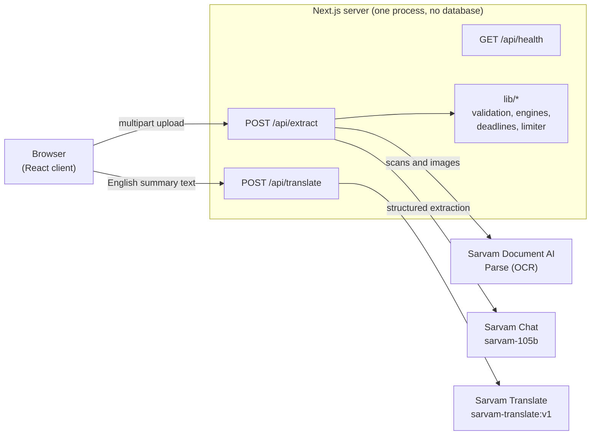

# PathWise

PathWise is a Next.js application that reads a small set of documents (government notices, bank letters, forms), extracts the action each one asks for, works out which actions must happen before others, and presents the result as a prioritised task list. OCR, structured extraction and translation are delegated to [Sarvam AI](https://www.sarvam.ai) APIs.

> **Status: v0.1.0, `"private": true`.** The end-to-end flow works and the `lib/` layer has substantial unit tests. However: accuracy on real documents has not been measured, cross-document dependency detection has never been benchmarked against a live model, there is no authentication, and rate limiting is in-memory and per-process. Read [Known limitations](docs/known-limitations.md) before exposing this to real users or real documents.

The repository directory is called `sarvam.ai`; the package and product name is `pathwise`.

## What it does

- Accepts up to 5 documents per analysis: text (pasted or `.txt`), PDF, PNG, JPEG and WebP (WebP is converted to PNG in the browser).
- Reads the text layer of digital PDFs locally; sends scans and images to Sarvam Document AI (OCR to markdown).
- Extracts one structured record per document with `sarvam-105b`, constrained by a JSON schema and validated with Zod: primary action, required documents, deadline, location, fees, consequence, conditions and supporting quotes.
- Checks that every quoted piece of evidence exists verbatim in the source text. Records that fail the check stay in the plan but are flagged and have their confidence capped at 0.4.
- With two or more readable documents, makes one more model call to propose dependencies and conflicts between documents. A dependency can only block a task if it carries a quote that verifies.
- Computes deadline distances, dependency resolution, cycle detection, urgency propagation and ordering in plain deterministic code on the server.
- Produces a plain-language English summary and translates it on demand into 22 Indian languages (Sarvam Translate).

## What it does not do

- **Store anything.** No database, no accounts, no browser storage. Results live in page state and disappear on refresh.
- **Extract more than one action per document.** Each document yields exactly one primary action.
- **Guarantee correctness.** Output is model-derived. "Verified" means the quoted text exists in the source, not that the interpretation is right.
- **Stream progress.** One request runs for tens of seconds (median about 30 s in the benchmark, worst case about 96 s).
- **Translate the plan table.** Only the text summary is translatable.
- **Scale horizontally as-is.** Rate-limit and concurrency state is held in process memory.
- **Accept Word, Excel or other formats.** Accepted: `.txt`, `.pdf`, `.png`, `.jpg`, `.jpeg`, `.webp`.

## How it works



1. **Digitise.** Text passes through; PDFs with a usable text layer are read locally with `unpdf`; scans and images go to OCR.
2. **Extract (Stage A).** One chat call per document, or per 50,000-character section for long ones.
3. **Verify.** Evidence quotes must appear verbatim in the source.
4. **Relate (Stage B).** With two or more documents, one call proposes dependencies and conflicts.
5. **Plan.** Deterministic code resolves dependencies, detects cycles, propagates urgency and orders the tasks.

Details: [Architecture](docs/architecture.md), [Extraction pipeline](docs/extraction-pipeline.md), [Planning engine](docs/planning-engine.md).

## Requirements

- Node.js `>=22.13.0` (`package.json` engines; `.nvmrc` pins major `22`) and npm `>=10`
- A Sarvam AI API key
- Docker, optional

## Quick start

```bash
nvm use                                   # Node 22 from .nvmrc
npm ci
echo 'SARVAM_API_KEY=your_key_here' > .env.local
npm run dev                               # http://localhost:3000
```

Two sample documents (an Aadhaar update appointment and a bank KYC notice) are preloaded on first visit. They are plain text, so analysing them needs a valid key but does not use OCR.

In development the server starts without a key, but every analysis and translation call fails until one is set. In production the key is mandatory (see [Configuration](docs/configuration.md)).

### Docker

```bash
docker build -t pathwise .
docker run -p 3000:3000 -e SARVAM_API_KEY=sk_... pathwise
```

The image is a three-stage build that runs the Next.js standalone server as a non-root user and defines a health check against `/api/health`. See [Deployment](docs/deployment.md).

## Commands

| Command                 | What it does                                                                            |
| ----------------------- | --------------------------------------------------------------------------------------- |
| `npm run dev`           | Next.js dev server                                                                      |
| `npm run build`         | Production build (standalone output)                                                    |
| `npm start`             | `next start`; the Docker image runs `node server.js` from the standalone output instead |
| `npm run lint`          | ESLint (`eslint-config-next/core-web-vitals`)                                           |
| `npm test`              | Vitest, single run, Node environment                                                    |
| `npm run test:watch`    | Vitest watch mode                                                                       |
| `npm run test:coverage` | Vitest with V8 coverage; fails below 75% line coverage on `lib/**`                      |
| `npm run test:ui`       | Vitest UI                                                                               |

## Configuration

The variables most people touch. The full list, defaults and caveats are in [Configuration](docs/configuration.md).

| Variable                  | Default        | Purpose                                                                                             |
| ------------------------- | -------------- | --------------------------------------------------------------------------------------------------- |
| `SARVAM_API_KEY`          | none           | Required in production at runtime                                                                   |
| `TRUSTED_PROXY_HOPS`      | `0`            | Number of trusted reverse proxies in front of the app. At `0`, per-client rate limiting is disabled |
| `SARVAM_MAX_TOKENS`       | `4096`         | Completion cap per model call. Truncated output fails the document                                  |
| `APP_TIMEZONE`            | `Asia/Kolkata` | Timezone used to decide what "today" is for deadlines                                               |
| `MAX_CONCURRENT_EXTRACTS` | `5`            | Hard cap on simultaneous analyses per process                                                       |

## Project layout

```
app/
  api/extract/route.js      POST: the analysis pipeline
  api/translate/route.js    POST: summary translation
  api/health/route.js       GET: liveness and config check
  page.js                   client state machine: upload -> loading -> results
components/                 React components (plan table, notices, upload, translation)
lib/
  sarvam.js                 Sarvam client: retries, OCR job lifecycle, chat, translate
  extraction.js             Stage A/B prompts, JSON schemas, sectioning
  validation.js             Evidence and page verification
  engines.js                Dependencies, cycles, urgency, priority, reasoning steps
  deadlines.js              Timezone-aware date arithmetic
  summary.js, insights.js   Summary text and UI insight derivation
  pdfText.js                Text-layer extraction via unpdf
  limiter.js, env.js, limits.js, apiError.js, languages.js
scripts/preflight/          Manual scripts that call the live Sarvam API
Dockerfile, railway.json, vercel.json
FIX_LOG.md                  Historical engineering log (not a specification)
PERFORMANCE-BENCHMARK.md    24-request benchmark on synthetic fixtures
```

## Documentation

| Document                                             | Read it for                                                               |
| ---------------------------------------------------- | ------------------------------------------------------------------------- |
| [Architecture](docs/architecture.md)                 | Components, request lifecycle, shared state, design decisions             |
| [Extraction pipeline](docs/extraction-pipeline.md)   | Digitisation, Stage A, evidence verification, Stage B, failure behaviour  |
| [Planning engine](docs/planning-engine.md)           | Deadlines, dependency resolution, urgency propagation, ordering, statuses |
| [API reference](docs/api-reference.md)               | Endpoints, request and response shapes, error codes, limits               |
| [Configuration](docs/configuration.md)               | Environment variables, limits, timeouts and retry policy                  |
| [Deployment](docs/deployment.md)                     | Docker, Railway, Vercel, reverse proxies, logging, troubleshooting        |
| [Security and privacy](docs/security-and-privacy.md) | Data flow, controls that exist, controls that do not                      |
| [Development](docs/development.md)                   | Local workflow, conventions, tests, changing the schema                   |
| [Known limitations](docs/known-limitations.md)       | What is unmeasured, unverified, unimplemented or out of date              |

## Testing

`npm test` runs Vitest in a Node environment with model and OCR calls mocked. There are no component tests, no end-to-end tests and no automated live-API tests. The scripts in `scripts/preflight/` call the real Sarvam API by hand to check assumptions; they spend API credits. See [Development](docs/development.md#testing).
