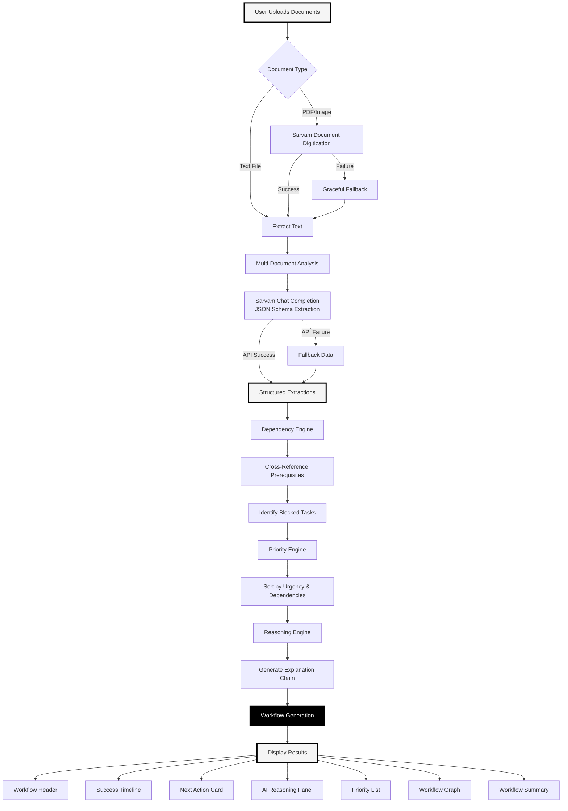
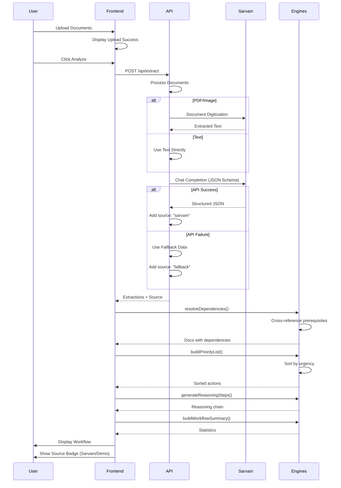

# PathWise - AI Government Workflow Planner

Turn multiple government notices into one clear action plan by finding dependencies between them.

## Overview

PathWise analyzes multiple government documents simultaneously to:

- Extract structured information from each document
- Detect dependencies between documents
- Generate a prioritized workflow
- Explain reasoning for every recommendation
- Cite sources for all claims

## Architecture



## System Flow



## Technology Stack

### Frontend

- **Framework**: Next.js 16 (App Router)
- **React**: 19
- **Styling**: Custom CSS (Neo-Brutalism theme)
- **State Management**: React useState hooks

### Backend

- **Runtime**: Node.js
- **API**: Next.js API Routes
- **Integration**: Sarvam AI API

### AI Integration

- **Provider**: Sarvam AI
- **Model**: sarvam-m
- **Extraction**: Structured JSON via JSON Schema
- **Digitization**: Document Digitization API (integration-ready)

## Features

### Implemented

**Multi-Document Analysis**

- Upload multiple text documents simultaneously
- Cross-document relationship detection
- Concurrent processing

**Dependency Detection**

- Identifies blocked tasks automatically
- Cross-references prerequisites against actions
- Fuzzy matching for flexible detection
- Explains WHY dependencies exist

**Source Citations**

- Every recommendation includes source document
- Page or section reference included
- Format: "Source: [Document] • [Page]"

**Explainability**

- AI Reasoning Panel shows step-by-step logic
- dependency_reason field for every dependency
- WHY explanations for prioritization
- Traceable to uploaded content

**Confidence Scores**

- Displayed as percentages (0-100%)
- Shown in Next Action Card
- Visible in Priority List
- Per-document confidence in Accordion

**Visual Design**

- Neo-Brutalism black and white theme
- Thick borders (3-4px)
- Brutal shadows (8px offset)
- High contrast for accessibility
- Responsive layout

**Error Handling**

- Graceful fallback to demo mode
- Never exposes stack traces
- Console logging for debugging
- Automatic recovery

**Loading States**

- 6-step pipeline animation
- Progressive checkmarks
- Clear status indicators

**Empty States**

- "No blocking dependencies detected"
- Complexity badges (Simple/Moderate/Complex)
- Estimated completion time

### Integration-Ready

**PDF/Image Digitization**

- Architecture prepared for Sarvam Document Digitization API
- Graceful fallback implemented
- User messaging explains current limitation
- Ready for production integration

## Installation

```bash
# Install dependencies
npm install

# Set up environment variables
cp .env.example .env.local

# Add your Sarvam API key to .env.local
SARVAM_API_KEY=your_api_key_here

# Run development server
npm run dev
```

Open [http://localhost:3000](http://localhost:3000)

## Environment Variables

```
SARVAM_API_KEY=your_sarvam_api_key
```

Get your API key from [https://sarvam.ai](https://sarvam.ai)

## Project Structure

```
sarvam.ai/
├── app/
│   ├── api/
│   │   └── extract/
│   │       └── route.js          # Sarvam API integration
│   ├── globals.css               # Neo-Brutalism theme
│   ├── layout.js                 # Root layout
│   └── page.js                   # Main application
├── components/
│   ├── AIReasoningPanel.js       # Step-by-step AI logic
│   ├── DocumentCards.js          # Document upload & display
│   ├── ExtractedInfoAccordion.js # Raw extraction data
│   ├── LoadingAnimation.js       # 6-step pipeline
│   ├── NextActionCard.js         # Primary recommendation
│   ├── PriorityList.js           # All actions sorted
│   ├── SuccessTimeline.js        # Processing progress
│   ├── WorkflowGraph.js          # Visual dependency map
│   ├── WorkflowHeader.js         # Summary statistics
│   └── WorkflowSummary.js        # Overview stats
├── lib/
│   └── engines.js                # Core logic engines
├── .env.example                  # Environment template
├── .env.local                    # Your API key (gitignored)
└── README.md                     # This file
```

## Core Engines

### Dependency Engine

**Function**: `resolveDependencies(docs)`

**Logic**:

1. Build action map (lowercase normalized)
2. For each document:
   - Match prerequisites against other actions
   - Use exact match first, then fuzzy substring
   - Find which docs this blocks
3. Return docs with `is_blocked`, `blocked_by`, `blocks`

### Priority Engine

**Function**: `buildPriorityList(docs)`

**Logic**:

1. Sort unblocked tasks first
2. Within each group, sort by deadline urgency
3. Return sorted array

### Reasoning Engine

**Function**: `generateReasoningSteps(prioritized)`

**Logic**:

1. Document scan step
2. Multi-document analysis step
3. Dependency detection steps (with WHY)
4. Priority calculation step
5. Recommended next action (with reasoning)
6. Return step array for display

### Summary Engine

**Function**: `buildWorkflowSummary(prioritized)`

**Logic**:

1. Count total documents
2. Count total actions
3. Count dependencies
4. Count blocked tasks
5. Sum estimated time
6. Return statistics object

## API Integration

### Sarvam Chat Completion

**Endpoint**: `https://api.sarvam.ai/v1/chat/completions`

**Request**:

```json
{
  "model": "sarvam-m",
  "messages": [
    {"role": "system", "content": "..."},
    {"role": "user", "content": "..."}
  ],
  "response_format": {
    "type": "json_schema",
    "json_schema": {...}
  },
  "temperature": 0.1
}
```

**Response Schema**:

```javascript
{
  extractions: [
    {
      document_type: string,
      organization: string,
      title: string,
      required_action: string,
      required_documents: string[],
      prerequisites: string[],
      deadline: string,
      deadline_days: number,
      estimated_time: string,
      consequence: string,
      confidence: number,
      source_document: string,
      source_page: string,
      dependency_reason: string
    }
  ]
}
```

### Fallback Behavior

When Sarvam API is unavailable:

1. API route detects error
2. Returns hardcoded `FALLBACK_EXTRACTIONS`
3. Sets `source: "fallback"`
4. Frontend shows "Demo Mode" badge
5. All features continue to work

## Design System

### Colors

- Black: `#000000`
- White: `#FFFFFF`
- Gray Light: `#F5F5F5`
- Gray Mid: `#E0E0E0`
- Gray Dark: `#333333`

### Borders

- Thick: 4px
- Medium: 3px
- Thin: 2px

### Shadows

- Brutal: `8px 8px 0 #000000`
- Brutal Large: `12px 12px 0 #000000`
- Brutal Small: `4px 4px 0 #000000`

### Typography

- Headings: 900 weight, uppercase
- Body: 600-700 weight
- Code: Courier New monospace

### Interactions

- Hover: Shadow expands, element lifts
- Active: Shadow collapses
- Focus: Bold border

## Usage

### Default Demo

1. Open application
2. See 2 pre-loaded documents
3. Click "Analyze Documents"
4. View generated workflow

### Upload Custom Documents

1. Click "Upload New Documents"
2. Select text files (.txt)
3. Documents appear in grid
4. Click "Analyze Documents"
5. View custom workflow

### Understanding Results

**Workflow Header**: Shows processing mode (Sarvam/Demo) and statistics

**Success Timeline**: 4-step progress indicator with complexity badge

**Next Action Card**: Primary recommendation with:

- Source citation
- Confidence score
- Urgent badge (if deadline ≤ 3 days)
- WHY explanation
- What to carry
- Expected result

**AI Reasoning Panel**: Step-by-step logic showing:

- Documents scanned
- Multi-document analysis
- Dependencies detected
- Priority calculation
- Final recommendation

**Priority List**: All actions with:

- Priority number
- Source citation
- Confidence percentage
- Dependency explanation
- Blocked status
- Status badge

**Workflow Graph**: Visual dependency map

**Workflow Summary**: Overall statistics

## Accuracy & Honesty

### What We Claim

- Multi-document text analysis
- Text file upload
- Sarvam AI chat completions integration
- Dependency detection with explanations
- Source citations
- Confidence scores
- Neo-Brutalism design

### What We Acknowledge

- PDF/Image digitization: Architecture ready, not fully integrated
- Text files recommended for best results
- Demo mode badge shown when using fallback

## Development

### Run Development Server

```bash
npm run dev
```

### Build for Production

```bash
npm run build
npm start
```

### Environment

- Node.js 18+
- Next.js 16
- React 19

## Known Limitations

1. **PDF/Image Processing**: Designed but requires Sarvam Document Digitization API verification
2. **Fallback Mode**: Uses hardcoded examples when API unavailable
3. **Text Input**: Most reliable for current demo

## Future Enhancements

1. Verify and integrate Sarvam Document Digitization API
2. Add support for more document types
3. Implement document history
4. Add export functionality
5. Multi-language support

## License

MIT

## Contact

Built for Sarvam AI Hackathon 2026
