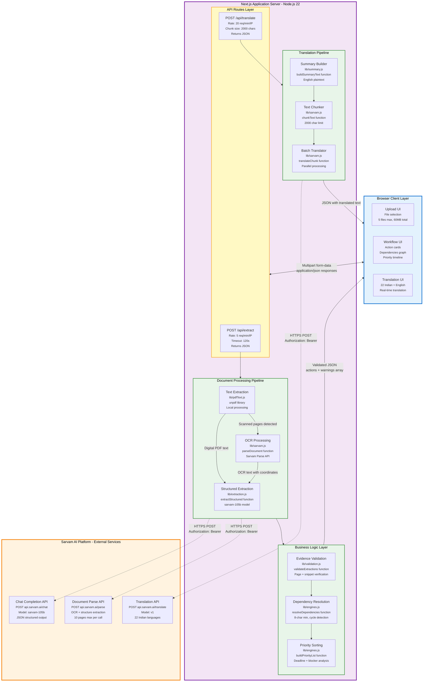
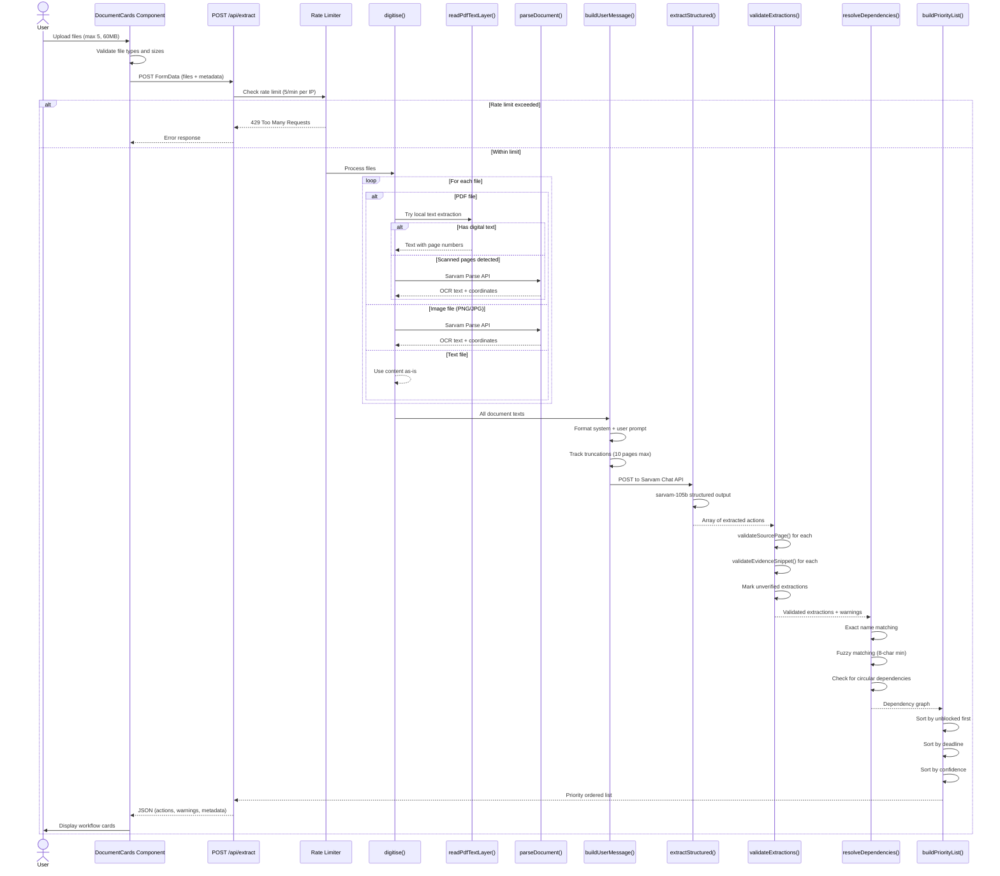
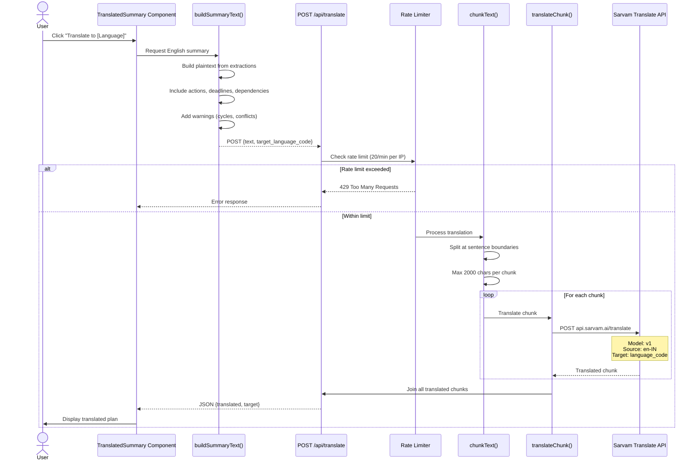

# Architecture Overview

PathWise is a single-service Next.js application that orchestrates document processing, AI extraction, dependency analysis, and translation.

## System Architecture



## Component Breakdown

### 1. Frontend (React/Next.js)

**Location:** `/app` and `/components`

**Responsibilities:**

- Document upload and file handling
- Language selection
- Result visualization
- Translation interface

**Key Components:**

- `DocumentCards.js` - Upload and document management
- `SimpleWorkflow.js` - Action plan display
- `TranslatedSummary.js` - Multi-language output
- `LoadingAnimation.js` - Processing feedback

### 2. API Layer

**Location:** `/app/api`

**Routes:**

#### POST `/api/extract`

- Accepts multipart form data (files + metadata)
- Orchestrates document processing pipeline
- Returns structured extractions with validation

#### POST `/api/translate`

- Accepts text and target language
- Chunks long text automatically
- Returns translated content

### 3. Document Processing Pipeline

**Location:** `/lib`

#### Stage 1: Text Extraction (`pdfText.js`, `sarvam.js`)

- **Digital PDFs:** Extract text layer locally using `unpdf` (fast, free)
- **Scanned PDFs/Images:** Send to Sarvam Document AI Parse (OCR)
- Detects mixed PDFs (some digital, some scanned pages)
- Preserves page boundaries for evidence validation

#### Stage 2: Structured Extraction (`extraction.js`, `sarvam.js`)

- Sends all document texts to Sarvam chat model (sarvam-105b)
- Uses structured JSON schema for consistent output
- Extracts actions, deadlines, dependencies, evidence
- Returns confidence scores and source references

#### Stage 3: Validation (`validation.js`)

- Verifies page numbers exist in source documents
- Validates evidence snippets against source text
- Marks unverified extractions
- Generates validation warnings

#### Stage 4: Dependency Analysis (`engines.js`)

- Exact matching on action names
- Evidence-based fuzzy matching (8+ char minimum)
- Prevents false positives from generic terms
- Detects circular dependencies
- Tracks blocking relationships

#### Stage 5: Prioritization (`engines.js`)

- Unblocked tasks before blocked
- Tasks that unblock others prioritized
- Earlier deadlines first
- Unknown deadlines after known ones
- Confidence as tie-breaker

#### Stage 6: Summary & Translation (`summary.js`, `sarvam.js`)

- Builds plain-language English summary
- Chunks text for translation (2000 char limit)
- Translates to target language
- Preserves formatting and order

### 4. Utility Modules

**Rate Limiting** (`limiter.js`)

- In-memory fixed-window rate limiter
- Separate limits for extraction and translation
- Supports trusted proxy detection (X-Forwarded-For)
- Automatic bucket cleanup

**Language Support** (`languages.js`)

- 23 language definitions (22 Indian + English)
- RTL script detection
- Native and romanized names

## Data Flow

### Document Upload to Analysis



### Translation Flow



## Key Design Decisions

### Single-Service Architecture

- **Why:** Simplicity, easier deployment, lower latency
- **Trade-off:** No independent scaling of document processing vs web UI
- **Mitigation:** Horizontal scaling via load balancer if needed

### Client-Side File Handling

- **Why:** Avoid file size limits in serverless environments
- **Implementation:** Files sent as multipart form data, processed in API route
- **Benefit:** Supports large scanned PDFs

### Eager Text Extraction

- **Why:** Digital PDF text extraction is instant and free
- **Implementation:** Try local extraction first, only OCR if needed
- **Benefit:** 10-50x faster for digital documents

### One LLM Call Per Upload

- **Why:** Cross-document reasoning requires seeing all documents together
- **Trade-off:** Longer response time for first result
- **Benefit:** Better dependency detection

### Evidence Validation Post-Extraction

- **Why:** LLMs can hallucinate page numbers and quotes
- **Implementation:** Validate after extraction, mark confidence
- **Benefit:** Transparency about unverified claims

### In-Memory Rate Limiting

- **Why:** Simple, fast, no external dependencies
- **Trade-off:** State lost on restart, doesn't work across multiple instances
- **When to upgrade:** Use Redis when scaling horizontally

## Scalability Considerations

### Current Limits

- **Single instance:** Handles ~50-100 concurrent analyses
- **Rate limiting:** Per-IP, in-memory (resets on restart)
- **File storage:** No persistence (processed on-the-fly)

### Scaling Strategies

**Horizontal Scaling:**

1. Add Redis for distributed rate limiting
2. Use load balancer (sticky sessions not needed)
3. Set `TRUST_PROXY=true` in environment

**Vertical Scaling:**

- Increase Node.js memory limit
- More CPU cores = more concurrent Sarvam API calls

**Optimization:**

- Cache Sarvam Parse results (if same file uploaded repeatedly)
- Pre-warm model with common document types
- Stream results as they become available

## Security Architecture

### Input Validation

- File type checking (MIME + extension)
- File size limits (25 MB per file, 60 MB total)
- Document count limits (5 files max)

### API Protection

- Rate limiting per IP
- Trusted proxy configuration
- API key validation
- Request timeout enforcement

### Data Privacy

- No document storage
- No logging of document contents
- Transient processing only
- Clear warning about external API usage

### Error Handling

- Never expose API keys in responses
- Sanitize error messages
- No stack traces in production

## Performance Characteristics

### Typical Response Times

- **Digital PDF (2 pages):** 5-8 seconds
- **Scanned PDF (5 pages):** 15-25 seconds
- **Mixed documents (3 files):** 20-35 seconds
- **Translation:** 2-5 seconds

### Bottlenecks

1. **Sarvam Parse OCR:** 3-8 seconds per page
2. **Structured extraction:** 5-15 seconds (depends on document count)
3. **Translation:** 1-3 seconds per chunk

### Optimization Opportunities

- Parallel document processing (already implemented)
- Streaming extraction results (not yet implemented)
- Client-side preview while processing (not yet implemented)

## Technology Stack

- **Framework:** Next.js 16 (React 19)
- **Runtime:** Node.js 22
- **PDF Processing:** unpdf
- **AI Models:** Sarvam AI (sarvam-105b, sarvam-vision, sarvam-translate:v1)
- **Testing:** Vitest
- **Deployment:** Docker (standalone output)

## File Structure

```
sarvam.ai/
├── app/
│   ├── api/              # API routes
│   │   ├── extract/
│   │   └── translate/
│   ├── layout.js         # Root layout
│   ├── page.js           # Main page
│   └── globals.css       # Styles
├── components/           # React components
├── lib/                  # Business logic
│   ├── engines.js        # Dependency & priority
│   ├── extraction.js     # Schema & prompts
│   ├── validation.js     # Evidence validation
│   ├── sarvam.js         # API client
│   ├── summary.js        # Summary builder
│   ├── limiter.js        # Rate limiting
│   ├── languages.js      # Language definitions
│   └── pdfText.js        # PDF text extraction
├── docs/                 # Documentation
├── public/               # Static assets
├── tests/                # Test files (*.test.js)
├── Dockerfile            # Container config
├── package.json          # Dependencies
└── vitest.config.js      # Test config
```

## Next Steps

- [How It Works](HOW_IT_WORKS.md) - Detailed processing walkthrough
- [Development Guide](DEVELOPMENT.md) - Set up local development
- [API Reference](API_REFERENCE.md) - Endpoint specifications
