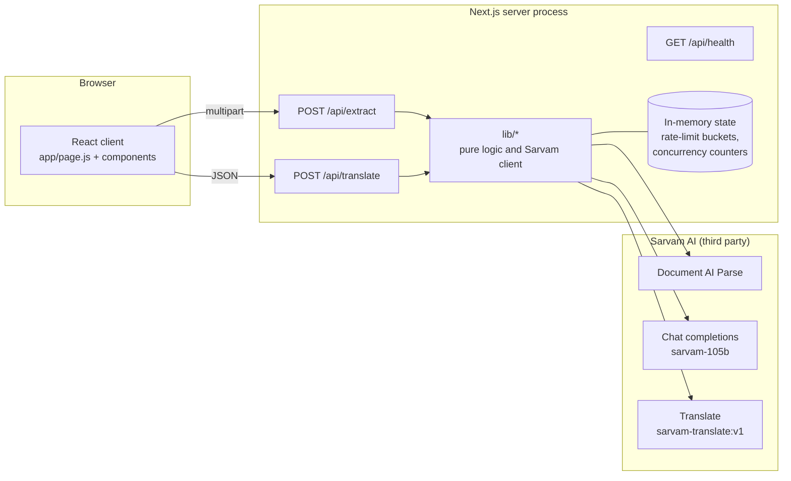
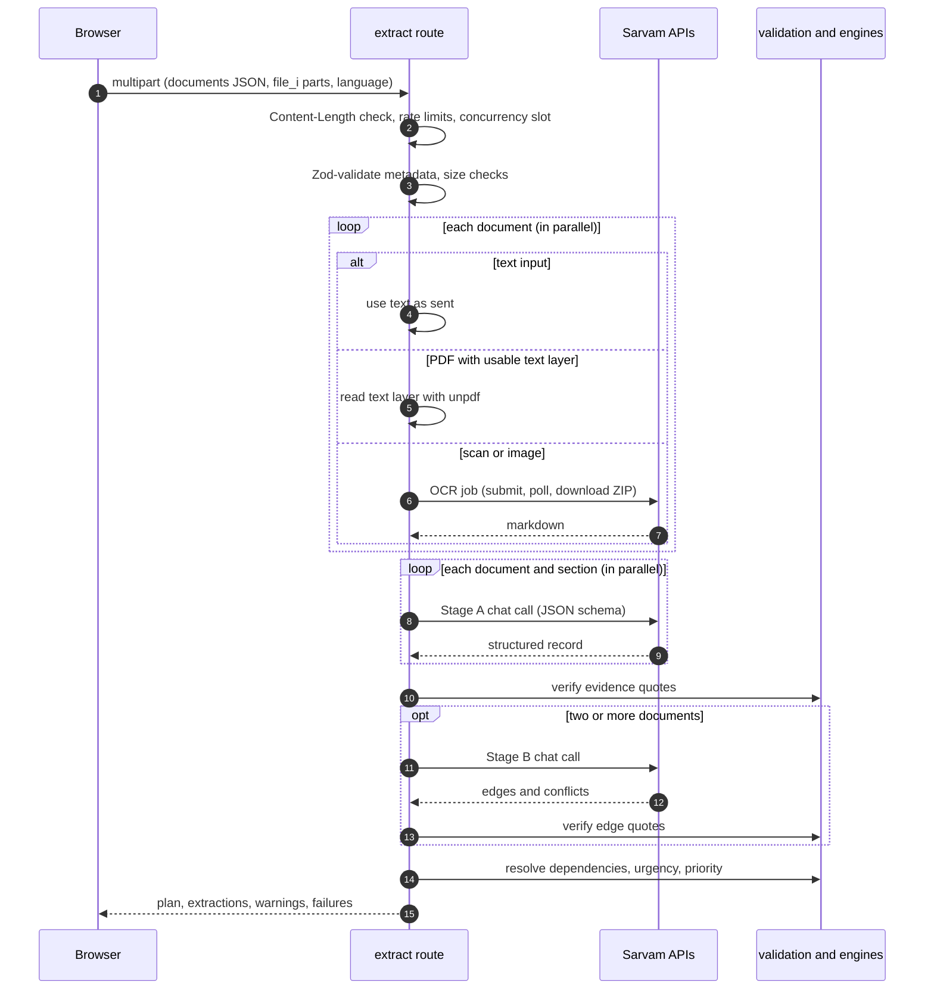
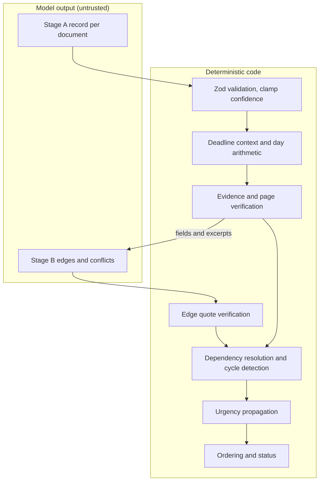
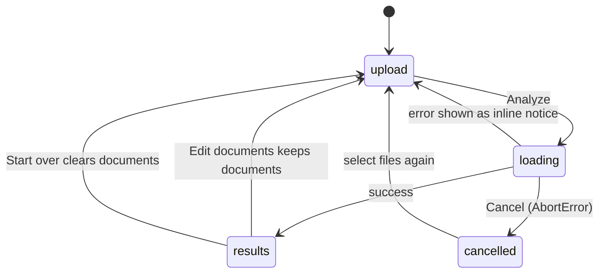

# Architecture

How the system is put together and why. Pipeline internals are in [Extraction pipeline](extraction-pipeline.md); ordering and deadline logic is in [Planning engine](planning-engine.md).

## Design principles

These are inferred from the code, not aspirational.

1. **The model extracts; code decides.** The model is asked to read a document and fill a schema. It is explicitly told not to compute `deadline_days`. Date arithmetic, dependency resolution, cycle detection, urgency propagation and ordering are plain JavaScript in `lib/deadlines.js` and `lib/engines.js`, with no I/O.
2. **Model output is untrusted input.** It is schema-constrained at the API, re-validated with Zod, and every quoted piece of evidence is checked against the source text. Failing the check lowers confidence; it does not silently pass.
3. **One deployable, no state.** A single Next.js app does UI, API and Sarvam calls. There is no database, queue, cache or object store. An earlier Python OCR service was removed.
4. **Fail per document where practical.** Documents are processed in parallel with individual error handling, so one unreadable file produces a `failures[]` entry rather than a failed request. There are exceptions (see [failure matrix](extraction-pipeline.md#failure-matrix)).

## Tech stack

| Concern             | Choice                                                                     |
| ------------------- | -------------------------------------------------------------------------- |
| Framework           | Next.js 16.4.3 (App Router), React 19.3.1 with the React Compiler enabled  |
| Language            | JavaScript (no TypeScript). `@/*` path alias via `jsconfig.json`           |
| Validation          | Zod 4                                                                      |
| PDF text            | `unpdf`                                                                    |
| OCR output handling | `adm-zip` (Sarvam returns a ZIP of markdown files)                         |
| Tests               | Vitest 5 (Node environment)                                                |
| Lint                | ESLint 9 with `eslint-config-next/core-web-vitals`                         |
| Runtime             | Node >= 22.13. Route handlers declare `runtime = "nodejs"`                 |
| Build output        | `output: "standalone"`; `adm-zip` and `unpdf` are `serverExternalPackages` |

`sharp` is listed in `package.json` but nothing in the code imports it; see [known limitations](known-limitations.md#unused-or-stale-items).

## System context

The server process is the only moving part besides Sarvam. Everything the server holds between requests is the `MEM` box: counters that reset on restart and are not shared across instances.

## Components

### Client

| File                                                                                               | Responsibility                                                                                                                                                                                                               |
| -------------------------------------------------------------------------------------------------- | ---------------------------------------------------------------------------------------------------------------------------------------------------------------------------------------------------------------------------- |
| `app/page.js`                                                                                      | Owns documents, language and results state. Runs the `upload / loading / results / cancelled` state machine, issues the `/api/extract` request with an `AbortController`, and maps API errors and warnings to inline notices |
| `components/DocumentCards.js`                                                                      | Upload zone (click and drag-and-drop), client-side type and size checks, WebP to PNG conversion, editable text for text documents, document-language select, bundled sample documents                                        |
| `components/LoadingAnimation.js`                                                                   | Indeterminate spinner, elapsed time, file count, cancel button. There is no real progress signal from the server                                                                                                             |
| `components/SimpleWorkflow.js`                                                                     | Plan table: status badge, deadline badge, verification badge, per-row evidence panel                                                                                                                                         |
| `components/NextActionCard.js`, `WorkflowSummary.js`, `DocumentInsights.js`, `AIReasoningPanel.js` | Presentation of the first task, summary counts, dates/fees/offices rollup, and the "How PathWise decided" steps                                                                                                              |
| `components/TranslatedSummary.js`                                                                  | Builds the English summary client-side from the plan, translates on click through `/api/translate`, caches per language per analysis                                                                                         |
| `components/Notice.js`                                                                             | Inline error/warning/info banner (replaces `alert()`)                                                                                                                                                                        |

### Server

| File                                                   | Responsibility                                                                                                                | Pure?               |
| ------------------------------------------------------ | ----------------------------------------------------------------------------------------------------------------------------- | ------------------- |
| `app/api/extract/route.js`                             | Orchestrates the pipeline: admission, digitise, Stage A, verification, Stage B, engines, response                             | No                  |
| `app/api/translate/route.js`                           | Validates input, rate limits, calls `translateText`                                                                           | No                  |
| `app/api/health/route.js`                              | Returns `{ ok, version, configured }`                                                                                         | No                  |
| `lib/sarvam.js`                                        | HTTP client for Sarvam: retry and backoff, OCR job lifecycle, structured chat call, chunked translation                       | No                  |
| `lib/pdfText.js`                                       | Text-layer extraction, password detection, text-quality ratio                                                                 | No                  |
| `lib/extraction.js`                                    | Stage A/B JSON schemas and prompts, label sanitising, sectioning                                                              | Yes                 |
| `lib/validation.js`                                    | Evidence and page verification, confidence capping                                                                            | Yes                 |
| `lib/engines.js`                                       | `resolveDependencies`, `tarjanSCC`, `propagateUrgency`, `buildPriorityList`, `generateReasoningSteps`, `buildWorkflowSummary` | Yes                 |
| `lib/deadlines.js`                                     | Timezone-aware calendar-day arithmetic and deadline description                                                               | Yes                 |
| `lib/summary.js`, `lib/insights.js`                    | Summary text and insight rollups used by the client                                                                           | Yes                 |
| `lib/limiter.js`                                       | Fixed-window rate limiter, extract concurrency slots, client IP derivation, `createLimiter`                                   | State in memory     |
| `lib/env.js`                                           | Zod-validated environment, loaded once at import                                                                              | Reads `process.env` |
| `lib/limits.js`, `lib/languages.js`, `lib/apiError.js` | Constants and the error response factory                                                                                      | Yes                 |

## Request lifecycle: `POST /api/extract`

Notes:

- The whole request runs under one deadline: `AbortSignal.any([request.signal, AbortSignal.timeout(285_000)])`. A client disconnect returns an empty `499`; hitting the deadline returns `504 UPSTREAM_TIMEOUT`. `maxDuration = 300` is exported for platforms that honour it and does nothing in a plain Docker deployment.
- The concurrency slot (`acquireExtractSlot`) is taken after the cheap rejections and released in `finally`.
- Stage B is skipped unless at least two documents survive Stage A.

## What is model output and what is code

Two things the diagram makes visible:

- **Conflicts are not verified.** Edges are checked against a quote; the `conflicts` list from Stage B is only filtered for valid document IDs. Its descriptions are surfaced as the model wrote them.
- **The "How PathWise decided" panel is templated.** `generateReasoningSteps` formats strings from deterministic facts (counts, blockers, deadlines). The only model-written text in it is the per-edge `reason` from Stage B.

## Concurrency and shared state

Per request:

- Documents are digitised in parallel, then analysed in parallel.
- A document over 50,000 characters is split into up to 6 sections analysed in parallel.
- Worst case for one request: 5 documents x 6 sections = 30 Stage A calls, plus one Stage B call (and one repair for each stage if needed).

Process-wide (shared across all requests in the same Node process):

| Limiter              | Value                                                                            | Effect                                                  |
| -------------------- | -------------------------------------------------------------------------------- | ------------------------------------------------------- |
| OCR parse jobs       | 3 concurrent                                                                     | Queued, not rejected                                    |
| Chat completions     | 4 concurrent                                                                     | Queued, not rejected                                    |
| Translate chunks     | 4 concurrent                                                                     | Queued, not rejected                                    |
| In-flight analyses   | `MAX_CONCURRENT_EXTRACTS` (default 5)                                            | Rejected immediately with `503 SERVER_BUSY`             |
| Per-IP rate limit    | `RATE_LIMIT_PER_10_MIN` (default 10), `TRANSLATE_LIMIT_PER_10_MIN` (default 120) | `429`; only active when the client IP can be determined |
| Global hourly budget | `GLOBAL_EXTRACT_PER_HOUR` (200), `GLOBAL_TRANSLATE_PER_HOUR` (1200)              | `503 SERVER_BUSY`                                       |

All of this lives in module-level variables (`buckets`, `activeExtractJobs`, the three `createLimiter` closures). Consequences:

- Counters reset on restart or redeploy.
- Each instance keeps its own counters, so the limits are per instance, not per deployment.
- Because the chat limiter is shared, one large analysis delays every other request's model calls. Latency under concurrent load is dominated by this queue.

## Client state machine

`cancelled` renders the same screen as `upload` plus an info notice. A run counter (`analysisRunRef`) discards responses from superseded requests, so a late response cannot overwrite a newer state. "Start over" asks for confirmation before clearing.

## Notable decisions and trade-offs

**Single-call extraction per document instead of per page.** [`PERFORMANCE-BENCHMARK.md`](../PERFORMANCE-BENCHMARK.md) concludes that the data does not justify page-level extraction on page count alone: it would multiply calls and add reconciliation risk, and the 10-page fixtures did not truncate. The same benchmark shows output truncation is a real risk, tied to completion size rather than page count, in a small sample on repetitive synthetic documents. This is an open question, not a settled one.

**Strict verbatim evidence.** A quote must be a contiguous, case- and punctuation-sensitive substring of the source after Unicode NFC normalisation and whitespace collapsing. This is easy to reason about and rejects fabricated or stitched quotes, at the cost of rejecting legitimate quotes that omit intervening text. In the benchmark only 2 of 23 successful extractions passed it, mostly because the model joined non-adjacent passages.

**Server-side date arithmetic.** The model returns an absolute date or a relative number of days; the server computes the distance from "today" in `APP_TIMEZONE` (default `Asia/Kolkata`) using calendar days. This avoids model arithmetic errors and keeps the behaviour testable.

**One action per document.** The Stage A schema has a single `required_action`. This keeps the plan one row per document and makes dependency edges simple (`doc -> doc`), but a document that contains several independent tasks collapses to one. See [known limitations](known-limitations.md#extraction-quality).

**Summary text is built on the client.** `buildSummaryText` runs in the browser from the plan returned by the server, and that English text is what gets translated. The server never sees the summary until the user asks for a translation.

**Standalone output, Node-only routes.** Smaller Docker image and a `node server.js` entry point, at the price of needing Node-compatible hosting (no Edge runtime) because of `adm-zip` and `unpdf`.
