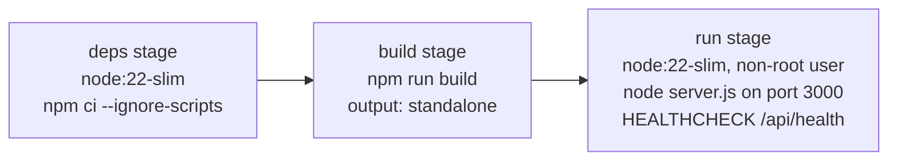

# Deployment

What the repository ships for deployment, what each option implies, and how to diagnose a running instance. The repository contains a Dockerfile, a `railway.json` and a `vercel.json`. It does not contain Kubernetes manifests, Terraform or a process manager configuration.

Contents: [Constraints](#constraints-that-apply-everywhere) · [Docker](#docker) · [Railway](#railway) · [Vercel](#vercel) · [Behind a proxy](#behind-a-reverse-proxy) · [Health](#health-checks) · [Logging](#logging) · [Troubleshooting](#troubleshooting)

## Constraints that apply everywhere

- **Node runtime only.** The routes use `adm-zip`, `unpdf` and Node `crypto`, and declare `runtime = "nodejs"`. Edge runtimes will not work.
- **Outbound HTTPS to Sarvam** (`api.sarvam.ai` and its OCR download host) must be reachable.
- **Long requests.** An analysis can run for tens of seconds and is cut off at 285 s. Any proxy or platform in front must allow responses that slow. `maxDuration = 300` is exported on the extract route, but only platforms that read it honour it.
- **Request bodies up to 62 MB.** Proxies with a lower body limit will reject uploads before the app sees them.
- **State is in process memory.** Rate limits and the concurrency cap are per instance and reset on restart (see [Architecture](architecture.md#concurrency-and-shared-state)). Running several instances multiplies every limit by the instance count. `lib/limiter.js` says a Redis-backed store would be needed for multi-instance deployments; that is not implemented.
- **Platform timeouts are your responsibility.** Check that your host's function or request duration limit is at least as long as the analyses you expect.
- **TLS is terminated outside the app.** The app speaks plain HTTP.

## Docker

```bash
docker build -t pathwise .
docker run -p 3000:3000 -e SARVAM_API_KEY=sk_... pathwise
```



| Aspect             | Detail                                                                                                                                      |
| ------------------ | ------------------------------------------------------------------------------------------------------------------------------------------- |
| Base image         | `node:22-slim` in all stages                                                                                                                |
| Dependency install | `npm ci --ignore-scripts` (lifecycle scripts of dependencies are skipped)                                                                   |
| Build              | `NEXT_TELEMETRY_DISABLED=1`; `public/` is created if missing so the later `COPY` cannot fail                                                |
| Runtime user       | System user and group `pathwise`; the app does not run as root                                                                              |
| Runtime env        | `NODE_ENV=production`, `PORT=3000`, `HOSTNAME=0.0.0.0`                                                                                      |
| Entry point        | `node server.js` from `.next/standalone`                                                                                                    |
| Health check       | Every 30 s, 5 s timeout, 10 s start period, 3 retries; passes when `GET /api/health` returns 200                                            |
| Build context      | `.dockerignore` excludes `node_modules`, `.next`, `.git`, `.env*`, tests, `docs/`, `scripts/preflight/` and all Markdown except `README.md` |

`next build` succeeds without `SARVAM_API_KEY`, because `lib/env.js` skips the key check during the production build phase. At runtime the key is required.

`FIX_LOG.md` records one successful image build with a passing health check, and a later entry where Docker verification was deferred. Treat the image as expected to work, and verify it in your own pipeline.

`HTTPS_ONLY` has to be supplied at build time to affect the CSP, and this Dockerfile does not pass it. See [Configuration](configuration.md#https_only).

## Railway

`railway.json`:

- Builder: the Dockerfile.
- Health check path: `/api/health`.
- Restart policy: on failure, up to 10 retries.

Set `SARVAM_API_KEY` in the Railway service variables. Set `TRUSTED_PROXY_HOPS` according to what Railway puts in `X-Forwarded-For`; the comment in `lib/limiter.js` suggests `1` for Railway and Render, but confirm it for your setup. Until it is set, per-client rate limiting is off.

## Vercel

`vercel.json` sets the build and install commands, `framework: nextjs`, region `bom1` (Mumbai) and maps `SARVAM_API_KEY` from a Vercel secret named `sarvam-api-key`.

Things to check before choosing Vercel:

- **Function duration.** The extract route exports `maxDuration = 300`. Whether your plan allows it is a platform matter.
- **Per-instance state.** Serverless instances do not share memory. The rate limit, the hourly budget and the concurrency cap apply per instance, so they provide much weaker protection than the same values on a single long-lived server.
- **Request size.** Platform request body limits can be lower than the 60 MB the app accepts.
- The standalone Docker output and `HEALTHCHECK` are not used on Vercel.

This project was not verified on Vercel in the files reviewed; the config exists, but there is no record of a deployment.

## Behind a reverse proxy

- Set `TRUSTED_PROXY_HOPS` to the number of trusted proxies. See [Configuration](configuration.md#reverse-proxies-and-client-ip).
- Allow request bodies of at least 62 MB and response times of at least 285 s.
- Terminate TLS at the proxy. If you do, building with `HTTPS_ONLY=true` adds `upgrade-insecure-requests` to the CSP.
- The app sets its own security headers (`X-Content-Type-Options`, `X-Frame-Options: DENY`, `Referrer-Policy`, `Permissions-Policy`, a CSP) and `Cache-Control: no-store` on `/api/*`. See [Security](security-and-privacy.md#http-hardening).

## Health checks

`GET /api/health` returns `{ ok, version, configured }`. It confirms the process is serving requests and that a key is present. It does not exercise Sarvam, so a revoked or invalid key still reports healthy.

## Logging

Structured JSON lines on stdout and stderr; the event catalogue is in [Extraction pipeline](extraction-pipeline.md#observability). There is no log shipping, metrics endpoint or tracing integration. Operationally useful fields:

- `request_id` on every line for a request, and in the `error.request_id` returned to the client. Ask users for the request ID shown in error notices.
- `upstream_status` on failures.
- `finish_reason` and `output_classification` on `pathwise_model_call`, which show truncation.
- `pathwise_extract_timing` for a per-stage latency breakdown.

Document text and API keys are not logged. File names are included in some error lines, so check that against your own logging policy.

## Troubleshooting

| Symptom                                                                                                                      | Likely cause                                                                                                                                           | How to confirm                                                                                                             |
| ---------------------------------------------------------------------------------------------------------------------------- | ------------------------------------------------------------------------------------------------------------------------------------------------------ | -------------------------------------------------------------------------------------------------------------------------- |
| Every analysis fails with "This document could not be analyzed/processed", or `EXTRACTION_INVALID` / `NO_READABLE_DOCUMENTS` | Invalid or missing API key, Sarvam outage, or quota. Credential errors are caught per document and do not surface as `UPSTREAM_AUTH` on `/api/extract` | Look for `upstream_status` 401/403/429 in the logs                                                                         |
| Individual documents fail while others succeed                                                                               | Model output truncated, or schema-invalid twice                                                                                                        | `pathwise_model_call` with `finish_reason: "length"` or `output_classification: "truncated"`. Consider `SARVAM_MAX_TOKENS` |
| `504 UPSTREAM_TIMEOUT`                                                                                                       | 285 s deadline reached. Typical causes: several large scanned PDFs, repeated Sarvam retries, or a backed-up chat queue                                 | `pathwise_extract_timing`, `pathwise_ocr_timing`                                                                           |
| `503 SERVER_BUSY`                                                                                                            | `MAX_CONCURRENT_EXTRACTS` reached, or the hourly budget is used up                                                                                     | Compare traffic to `MAX_CONCURRENT_EXTRACTS` and `GLOBAL_EXTRACT_PER_HOUR`                                                 |
| No `429` ever occurs under load                                                                                              | `TRUSTED_PROXY_HOPS=0` disables per-IP limiting, or hops is higher than the number of `X-Forwarded-For` entries                                        | A one-time production warning about `TRUSTED_PROXY_HOPS=0` in the logs                                                     |
| All users hit `429` together                                                                                                 | Hops set too low, so everyone shares the proxy's address                                                                                               | Inspect the real `X-Forwarded-For` from your proxy                                                                         |
| Container restarts or health check fails right after start in production                                                     | Missing or placeholder `SARVAM_API_KEY`: `lib/env.js` throws on import                                                                                 | Container logs: "Environment configuration error"                                                                          |
| OCR works locally but fails in a restricted network                                                                          | Outbound access to the Sarvam OCR download host is blocked                                                                                             | `Could not download OCR output` in logs                                                                                    |
| Scanned documents produce plans where page evidence shows `~ partial`                                                        | Normal for OCR output without per-page text                                                                                                            | See [Evidence verification](extraction-pipeline.md#4-evidence-verification)                                                |
| Analyses are slow                                                                                                            | Expected: median about 30 s per request in the benchmark, with outliers near 96 s from retries                                                         | [Known limitations](known-limitations.md#reliability-and-latency)                                                          |
