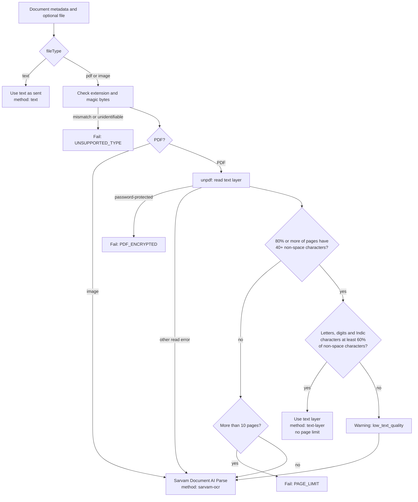
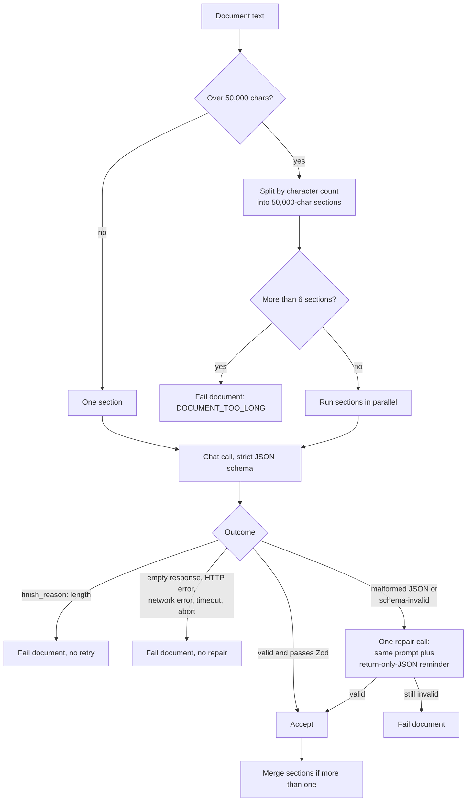
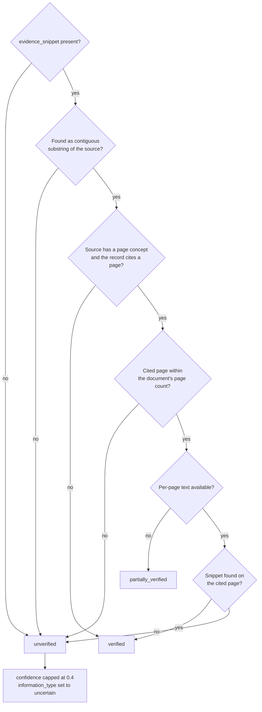
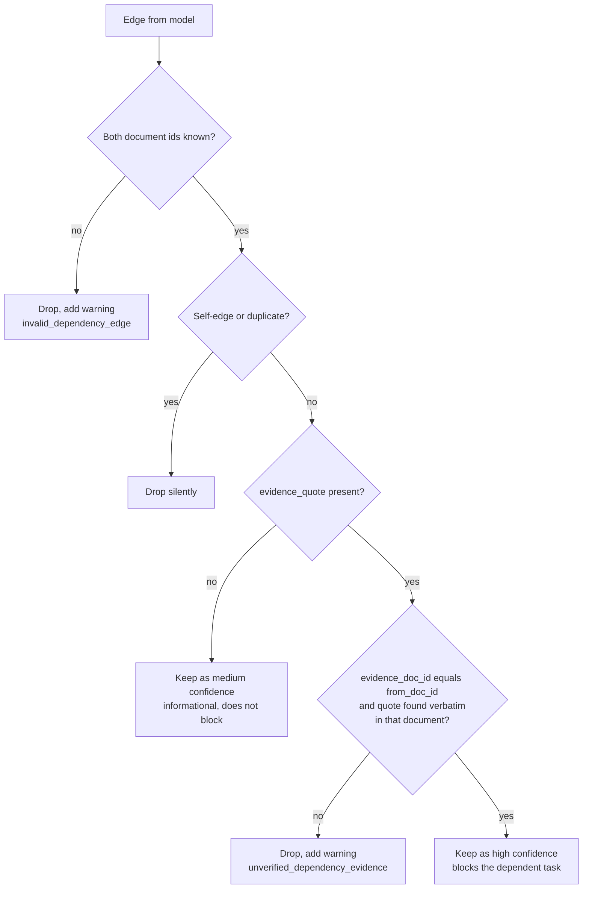

# Extraction pipeline

What happens inside `POST /api/extract` (`app/api/extract/route.js`), from admission to the hand-off to the planning engine. Where behaviour is surprising or differs from what a test or log suggests, it is called out.

Contents: [Admission](#1-admission) · [Digitisation](#2-digitisation) · [Stage A](#3-stage-a-per-document-extraction) · [Evidence verification](#4-evidence-verification) · [Stage B](#5-stage-b-cross-document-relationships) · [Failure matrix](#failure-matrix) · [Observability](#observability)

## 1. Admission

Checks run in this order and cost almost nothing, so they run before the body is parsed or any Sarvam call is made.

| #   | Check                                                                                                               | Rejection                                                       |
| --- | ------------------------------------------------------------------------------------------------------------------- | --------------------------------------------------------------- |
| 1   | `Content-Length` greater than `MAX_TOTAL_BYTES` + 2 MB (62 MB)                                                      | `413 FILE_TOO_LARGE`                                            |
| 2   | Per-IP rate limit (skipped when the client IP is `unknown`, which is the default)                                   | `429 RATE_LIMITED` with `Retry-After` and `RateLimit-*` headers |
| 3   | Global hourly budget (`GLOBAL_EXTRACT_PER_HOUR`)                                                                    | `503 SERVER_BUSY`                                               |
| 4   | Concurrency slot (`MAX_CONCURRENT_EXTRACTS`)                                                                        | `503 SERVER_BUSY`                                               |
| 5   | Parse multipart body                                                                                                | `400 INVALID_REQUEST`                                           |
| 6   | `documents` is valid JSON matching the Zod schema (1 to 5 entries); labels sanitised; whitespace-only text rejected | `400 INVALID_REQUEST` or `400 TOO_MANY_FILES`                   |
| 7   | Each file at most 25 MB, total at most 60 MB                                                                        | `413 FILE_TOO_LARGE`                                            |

The `Content-Length` check only helps when the header is present. A chunked upload skips it, and `request.formData()` buffers the whole body before checks 6 and 7 can run. See [security](security-and-privacy.md#upload-handling).

The `language` form field is the language of the _documents_ (an OCR hint). Values not in `lib/languages.js` silently fall back to `en-IN`.

## 2. Digitisation

Each document is turned into text by `digitise()`. Documents are processed in parallel, and a failure in one does not stop the others.

Details that matter:

- **Accepted types.** The declared extension must be `pdf`, `png`, `jpg` or `jpeg`. If the magic bytes are identifiable and disagree with the extension, the file is rejected. `.webp` never reaches the server; the browser converts it to PNG first.
- **Mixed PDFs.** A PDF with some pages of text and some scans is treated as a scan as a whole, so no page is silently empty.
- **Page limits.** Digital PDFs have no page limit (text volume is bounded later by sectioning). Scanned PDFs over 10 pages (`MAX_PARSE_PAGES`) are rejected before OCR. The low-quality-text fallback goes to OCR _without_ this pre-check, so the limit there is whatever Sarvam enforces. Images are single pages.
- **Text-layer output** is prefixed per page with `--- Page N ---`. The sectioning and page-verification code depend on this marker.
- **Password detection** is by exception name or message text (`password`, `encrypted`).

### OCR job lifecycle (`lib/sarvam.js`, `parseDocument`)

1. `POST /doc-ai/v1/job/parse` with `file`, `language` and `output_format=md` (60 s call budget).
2. Poll `/doc-ai/v1/job/{id}/status`. Sleep intervals are 1.5 s, 2 s, 2 s, 3 s, 3 s and then 5 s repeating. Terminal states: `completed`, `partially_completed`, `failed`, `rejected`. An unrecognised or missing status is tolerated twice and fails on the third consecutive read. Total polling is capped by `PARSE_TIMEOUT_MS` (default 180 s).
3. `GET /doc-ai/v1/job/{id}/download-url`, then validate the URL: HTTPS, no credentials or port, host is `api.sarvam.ai`, `appsprodaksharpublicsa.blob.core.windows.net`, or ends in `.sarvam.ai`.
4. Download the ZIP with `redirect: "error"`. Limits: 100 MB compressed, 500 MB declared decompressed.
5. Read the `.md` entries ordered by trailing number. One entry is used as-is; several are joined with `--- Page N ---` markers. Output over 2 MB of text is rejected.

`partially_completed` is accepted and surfaces a `partial_ocr` warning with page counts when Sarvam reports them. At most 3 OCR jobs run at once across the whole process.

**What is not known.** The exact page-delimiter format inside Sarvam's markdown is undocumented, and the code only inserts markers when the ZIP has several `.md` files. A multi-page scan delivered as a single `.md` therefore has no per-page text, which limits page-level evidence checks for OCR documents to `partially_verified` (see [section 4](#4-evidence-verification)).

### Digitisation errors

Only `UNSUPPORTED_TYPE`, `PDF_ENCRYPTED` and `PAGE_LIMIT` messages are shown to the user. Every other error becomes the generic `"This document could not be processed."` with code `OCR_FAILED`. If every document fails here, the response is `422 NO_READABLE_DOCUMENTS` with the per-file `failures`.

## 3. Stage A: per-document extraction

One structured record per document (or per section, then merged).

### Model call

| Parameter          | Value                                                                        |
| ------------------ | ---------------------------------------------------------------------------- |
| Endpoint           | `POST /v1/chat/completions`                                                  |
| Model              | `SARVAM_CHAT_MODEL`, default `sarvam-105b`                                   |
| `temperature`      | `0`                                                                          |
| `response_format`  | `{ type: "json_schema", json_schema: STAGE_A_SCHEMA }` with `strict: true`   |
| `max_tokens`       | `SARVAM_MAX_TOKENS`, default `4096`                                          |
| `reasoning_effort` | Sent only if `SARVAM_REASONING_EFFORT` is set (`none`, `low`, `high`, `max`) |
| Per-call budget    | 120 s including retries and backoff                                          |

The system prompt is built per request with today's date in `APP_TIMEZONE`. The document is wrapped in a `<document>` element; a literal `</document>` inside the text is escaped, and title, file name and source are stripped of quotes, angle brackets, `---` and newlines (`sanitizeLabel`).

### What the record contains

| Group      | Fields                                                                                                                                                                              |
| ---------- | ----------------------------------------------------------------------------------------------------------------------------------------------------------------------------------- |
| Identity   | `document_type`, `organization`, `title`, `reference_number`                                                                                                                        |
| The task   | `required_action` (imperative, up to 140 chars), `required_documents[]`, `prerequisites[]`, `consequence`, `fees`, `office_location`, `estimated_time_minutes`                      |
| Timing     | `deadline_text` (verbatim), `deadline_date` (`YYYY-MM-DD`), `deadline_relative_days`, `deadline_relative_anchor`, `appointment_date`, `appointment_time`, `deadline_context`        |
| Conditions | `conditional_requirements[]`: effect (`requirement` or `exception`), which fields it qualifies, trigger, affected group, deadline, consequence, quote                               |
| Provenance | `confidence` (0 to 1), `information_type` (`explicitly_stated`, `clearly_inferred`, `uncertain`), `source_page`, `evidence_snippet`, `field_evidence[]` (field, value, quote, page) |

Prompt rules that shape behaviour: never invent information; quotes must be contiguous verbatim spans; historical dates are recorded but not classified as active; a condition, its audience, action, deadline and consequence are kept together as one linked item; exceptions stay exceptions; document text is untrusted and must not be obeyed. These are instructions to the model. Only the quote rules are enforced by code (section 4).

### Validation and repair

The model output is re-validated with Zod (`StageAOutputSchema` in `route.js`). Non-critical fields use tolerant fallbacks (`.catch(...)`), unknown fields are dropped and confidence is clamped to 0 to 1 with a fallback of `0.5`. A record without a non-empty `document_type` and `required_action` is invalid.

Behaviour worth knowing:

- **Truncation is not retried.** If the model hits `max_tokens`, the document fails with a generic message. The error text mentions raising `SARVAM_MAX_TOKENS`, but the user only sees `"This document could not be analyzed."`; the detail is in the server log.
- **Empty responses are not repaired.** `extractStructured` tags an empty response with its own classification, and the repair branch only triggers on `malformed_json` or `schema_invalid`. One route test is titled "repairs empty model content exactly once" and passes, but only because its mock throws an error with no classification. Real empty responses take the no-repair path.
- **HTTP errors are retried below this level.** `sarvamFetch` retries 429, 502, 503, 504 and network errors up to 4 more times with exponential backoff before Stage A sees a failure (see [Configuration](configuration.md#retry-and-timeout-policy)).
- **Sectioning is a hard character split**, not paragraph-aware. A sentence can straddle a boundary, and a quote spanning two sections cannot be produced by either. Splits avoid breaking a UTF-16 surrogate pair.
- **Max size.** 6 sections x 50,000 chars caps one document at about 300,000 characters of analysable text. `MAX_TOTAL_CHARS` (150,000) in `lib/limits.js` is defined but unused.

### Merging sections

`mergeStageASections` keeps exactly one record per document:

- The highest-confidence section is the base, so `required_action`, `title`, `document_type`, `organization` and `reference_number` come from it.
- `required_documents` and `prerequisites` are unioned and de-duplicated.
- The earliest absolute `deadline_date` wins, taking its text and relative fields with it. If none is absolute, the first section with a `deadline_text` is used.
- `confidence` is the mean, `information_type` is the most cautious of the sections.
- `consequence`, `fees`, `office_location`, `appointment_date` and `appointment_time` are filled from lower-confidence sections when the base has none.
- `field_evidence` and `conditional_requirements` are concatenated and de-duplicated.

The consequence for long documents: different actions in different sections collapse to the base section's action.

### Server-computed fields

After the merge, the route adds `id` / `doc_id` (`doc1`, `doc2`, ... in upload order), `doc_index` (0-based), `file_name`, `deadline_context`, `deadline_days` and `deadline_status`. How these are derived is described in [Planning engine](planning-engine.md#deadline-context-and-status).

## 4. Evidence verification

`validateExtractions` in `lib/validation.js` checks each record against the text that was actually sent to the model. Identity is resolved by `doc_index` only, never by file name, because names are user-controlled and may repeat.

**Matching rule.** Both the quote and the source are normalised with Unicode NFC and whitespace collapse. The quote must then be a contiguous substring, still case- and punctuation-sensitive. Quotes shorter than 8 normalised characters cannot be verified. There is no fuzzy matching.

The record's `verification_status` is derived from `evidence_snippet` and `source_page`:

| Status               | Meaning                                                                                                      | Effect                                                                                      |
| -------------------- | ------------------------------------------------------------------------------------------------------------ | ------------------------------------------------------------------------------------------- |
| `verified`           | Snippet found verbatim, and the cited page (if any) is confirmed                                             | None                                                                                        |
| `partially_verified` | Snippet found, cited page is plausible, but there is no per-page text to confirm it (typical for OCR output) | None. Shown as `~ partial` in the UI                                                        |
| `unverified`         | No snippet, snippet not found, or page claim wrong                                                           | Confidence capped at 0.4, `information_type` forced to `uncertain`. Shown as `? unverified` |

Rules to be aware of:

- **Nothing is dropped.** An `unverified` record stays in the plan, flagged. A single aggregated `validation` warning is added to the response.
- **The record-level status depends on one snippet.** `field_evidence[]` and `conditional_requirements[]` are verified individually and reported in `field_evidence_status` and `field_evidence_coverage` (verified count, required count, ratio), but they do not change the record-level status or the confidence cap. One good snippet can mark a record `verified` while other cited fields are unverified.
- **Verbatim does not mean trustworthy.** The check proves a sentence exists in the document. It does not prove the document is genuine, or that the extracted interpretation of the sentence is right.

In the [benchmark](../PERFORMANCE-BENCHMARK.md), evidence passed validation in only 2 of 23 successful extractions, usually because the model stitched non-adjacent sentences into one quote. Under these rules most of those records would be flagged `unverified`.

## 5. Stage B: cross-document relationships

Runs only when at least two records survived Stage A and verification. It proposes edges ("A cannot proceed until B is done") and conflicts (contradictory dates, locations, fees).

**Input.** For each document: the Stage A fields (action, prerequisites, required documents, deadline) and a text excerpt. The excerpt is the full text if it is 1,500 characters or fewer; otherwise the first 490, the middle 490 and the last 490 characters joined with `...`. Stage B does not see the full documents.

**Call.** Same model and parameters as Stage A with `STAGE_B_SCHEMA`; no section splitting.

- The quote is verified against the **full** text of the dependent document, not the excerpt the model saw.
- Conflicts are kept if every referenced `doc_id` is valid. They are not evidence-checked. Each kept conflict is attached to the affected extractions and counted in a `conflicts` warning.

**Failure handling differs from Stage A:**

| Stage B failure                                                                             | Result                                                                                                                        |
| ------------------------------------------------------------------------------------------- | ----------------------------------------------------------------------------------------------------------------------------- |
| Invalid output, or any error that is not a `SarvamError` (this includes a per-call timeout) | One repair call. If that fails too, a `dependency_analysis_failed` warning is added and the plan is built without model edges |
| Schema mismatch after a successful call                                                     | `dependency_analysis_failed` warning, no repair                                                                               |
| Upstream HTTP error after retries (a `SarvamError` that is not invalid output)              | **The whole request fails** through `mapSarvamError`, even though Stage A succeeded                                           |
| Request deadline or client abort                                                            | `504` or `499` as for the rest of the request                                                                                 |

## Failure matrix

| Condition                                                                | Scope             | Outcome                                                |
| ------------------------------------------------------------------------ | ----------------- | ------------------------------------------------------ |
| Unsupported or mismatched file, encrypted PDF, scanned PDF over 10 pages | That document     | `failures[]` entry with a specific message             |
| Any other digitisation error                                             | That document     | `failures[]` entry, generic message, code `OCR_FAILED` |
| Every document fails digitisation                                        | Request           | `422 NO_READABLE_DOCUMENTS`                            |
| Document needs more than 6 sections                                      | That document     | `DOCUMENT_TOO_LONG`                                    |
| Stage A truncated, empty, HTTP, network or timeout failure               | That document     | `EXTRACTION_FAILED`, generic message, no repair        |
| Stage A malformed or schema-invalid output                               | That document     | One repair, then `EXTRACTION_FAILED`                   |
| Every document fails Stage A                                             | Request           | `502 EXTRACTION_INVALID` with `failures`               |
| Evidence cannot be verified                                              | That document     | Kept, `unverified`, confidence at most 0.4             |
| Stage B bad output                                                       | Dependencies only | Warning, plan without model edges                      |
| Stage B upstream HTTP error                                              | Request           | Mapped upstream error (see below)                      |
| Client disconnects                                                       | Request           | `499`, empty body                                      |
| 285 s deadline reached                                                   | Request           | `504 UPSTREAM_TIMEOUT`                                 |

Two consequences of how errors are routed:

- Stage A and OCR errors are caught per document, so credential errors (401/403) from Sarvam during extraction do **not** surface as `UPSTREAM_AUTH`. A bad API key shows up as generic per-document failures (`OCR_FAILED` / `EXTRACTION_FAILED`), or `EXTRACTION_INVALID` / `NO_READABLE_DOCUMENTS` if every document fails. The `upstream_status` in the server log is where the real cause is visible. `UPSTREAM_AUTH` is reachable from Stage B and from `/api/translate`.
- `mapSarvamError` maps 401/403 to `503 UPSTREAM_AUTH`, 429 to `503 UPSTREAM_RATE_LIMITED`, 504 / abort / "timeout" to `504 UPSTREAM_TIMEOUT`, 502/503 to `502 UPSTREAM_ERROR`, and any other 4xx/5xx to `502 UPSTREAM_ERROR`.

## Observability

Structured JSON logs go to stdout/stderr. They contain request IDs, stages, timings, token counts, status and classification values. By design and by test, they do not contain document text or API keys. File names do appear in some error logs.

| Event or shape                                                             | Emitted by                     | Content                                                                                                                   |
| -------------------------------------------------------------------------- | ------------------------------ | ------------------------------------------------------------------------------------------------------------------------- |
| `pathwise_extract_timing`                                                  | extract route, every request   | Upload, validation, digitisation, Stage A/B, repair, dependency and priority timings, total                               |
| `pathwise_model_call`                                                      | `extractStructured`            | Stage, attempt, model, input/output/reasoning tokens, `finish_reason`, output classification, queue and request durations |
| `pathwise_ocr_timing`                                                      | `parseDocument`                | Submit, poll, download and total durations, outcome                                                                       |
| `pathwise_ocr_partial`                                                     | OCR                            | Pages processed and failed                                                                                                |
| `pathwise_stage_a_output`                                                  | Stage A                        | Per-attempt classification                                                                                                |
| Error objects with `stage`, `error_code`, `upstream_status`, `description` | digitise, Stage A, outer catch | Sanitised diagnostics. Secrets, bearer tokens and response bodies are redacted and descriptions are cut to 300 characters |
| `{ request_id, code, status, ms }`                                         | `apiError`                     | One line per error response                                                                                               |

`reasoning_content` from the model is never read or logged.
