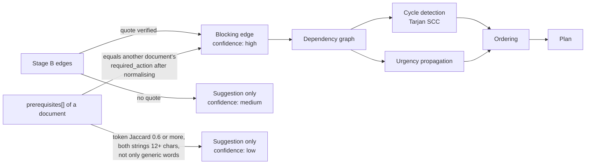
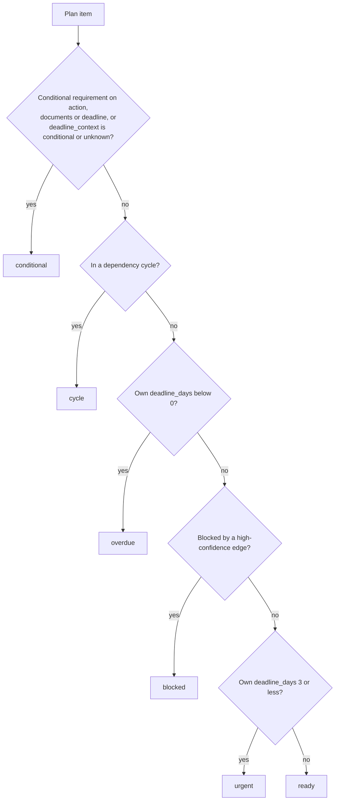
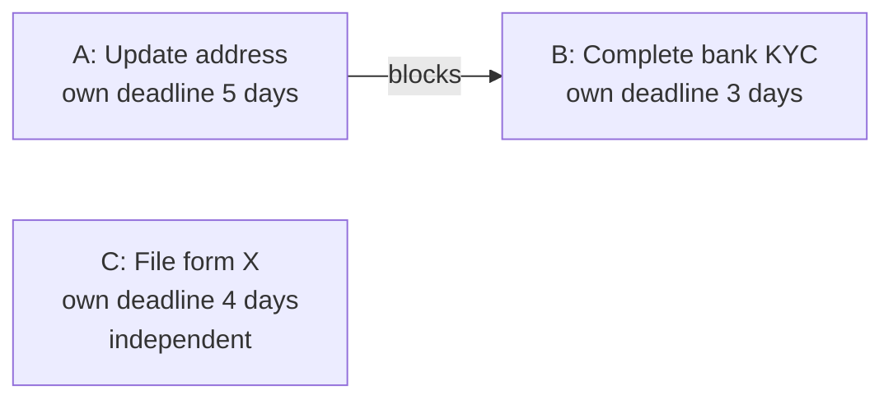

# Planning engine

Everything after extraction is deterministic: no model calls, no I/O. The logic lives in `lib/deadlines.js` and `lib/engines.js` and is called from the extract route. The same inputs always produce the same plan (with "today" as an input).

Contents: [Deadline context and status](#deadline-context-and-status) · [Dependency resolution](#dependency-resolution) · [Cycles](#cycles) · [Urgency propagation](#urgency-propagation) · [Ordering](#ordering) · [Task status](#task-status) · [Worked example](#worked-example) · [Derived text](#derived-text-summary-reasoning-insights) · [Limits of the approach](#limits-of-the-approach)

## Deadline context and status

The model supplies a deadline as text, an absolute date (`YYYY-MM-DD`), or a relative number of days with an anchor ("within 10 days of receipt"), plus a `deadline_context`. The route decides whether the date applies to the user today and computes the distance.

| Situation                                                                                                     | `deadline_context` | `deadline_days`          | `deadline_status`                                                      |
| ------------------------------------------------------------------------------------------------------------- | ------------------ | ------------------------ | ---------------------------------------------------------------------- |
| No deadline text, date or relative days                                                                       | `active`           | `null`                   | `unknown`                                                              |
| Model says the date is in the past or not addressed to the user                                               | `historical`       | `null`                   | `historical`                                                           |
| Model cannot tell whether it applies                                                                          | `unknown`          | `null`                   | `unknown`                                                              |
| Model says it is conditional, or a conditional requirement on `deadline` matches this deadline's date or text | `conditional`      | `null`                   | `conditional`                                                          |
| Otherwise                                                                                                     | `active`           | calendar days from today | `overdue`, `due_today`, `upcoming`, `relative_unanchored` or `unknown` |

Notes:

- `deadline_status: "unknown"` is used both for "no deadline" and for "applicability unknown". Use `deadline_context` to tell them apart.
- `relative_unanchored` means there is a relative deadline but no absolute date, because the anchor event (receipt of the notice, for example) has no known date. No day count is computed.
- **Day arithmetic** (`computeDeadlineDays`): both dates are reduced to calendar dates (today is taken in `APP_TIMEZONE`, default `Asia/Kolkata`) and the difference in whole days is returned. Invalid or implausible dates return `null`. The model's own arithmetic is never used.
- Historical and conditional deadlines never count as overdue, because `deadline_days` is `null` for them.

## Dependency resolution

`resolveDependencies(docs, edges)` decides which documents block which. There are three sources of evidence, with different strength.



| Source                           | Condition                                                                                                                                                                                                           | Result                                              |
| -------------------------------- | ------------------------------------------------------------------------------------------------------------------------------------------------------------------------------------------------------------------- | --------------------------------------------------- |
| Stage B edge with verified quote | See [Stage B](extraction-pipeline.md#5-stage-b-cross-document-relationships)                                                                                                                                        | Blocker (`high`, method `model`)                    |
| Stage B edge without a quote     |                                                                                                                                                                                                                     | Informational suggestion (`medium`, method `model`) |
| Exact match                      | A normalised `prerequisite` string equals another document's normalised `required_action`. Normalising lowercases, trims and strips trailing `.,;:`                                                                 | Blocker (`high`, method `exact`)                    |
| Fuzzy match                      | Prerequisite and the other action are both at least 12 characters, not made up only of generic words (`update`, `submit`, `complete`, `fill`, `provide`, `attach`), and word-set Jaccard similarity is at least 0.6 | Informational suggestion (`low`, method `fuzzy`)    |

Only `high` edges block. Each document gets:

- `blocked_by[]` and `blocks[]`: full extraction objects annotated with `_dependency_confidence`, `_dependency_method`, `_dependency_reason` and the evidence quote.
- `fuzzy_suggestions[]`: the `medium` and `low` candidates.
- `is_blocked` (any high blocker) and `is_fuzzy_only` (suggestions but no high blocker).
- `cycle_detected` and `cycle_path`.

The exact-match path requires two model-written strings to be identical after light normalisation, which is a narrow condition. How often each path produces edges on real documents has not been measured (see [known limitations](known-limitations.md#extraction-quality)).

## Cycles

`tarjanSCC` runs over the high-confidence edges. Any strongly connected component with more than one node is a cycle. Members get `cycle_detected: true`, are excluded from urgency propagation, are sorted after all non-cycle tasks, and get the status `cycle`. The UI shows "Circular dependency detected. Manual review required."

## Urgency propagation

A task that blocks an urgent task is itself urgent. `propagateUrgency` computes, for each document:

```
effective_deadline_days = min( own deadline_days,
                               effective_deadline_days of every task it blocks )
```

It iterates to a fixed point (bounded by the number of documents). Negative values (overdue) propagate. Cycle members keep their own deadline and are not updated. `null` means "no known deadline", and a known value always beats `null`.

`effective_deadline_days` drives ordering. It does not change the `deadline_days` shown in the row, nor the `urgent` status (see below).

## Ordering

`buildPriorityList` orders tasks with Kahn's algorithm and a priority queue, so a blocker always comes before the task it blocks. Among tasks that are ready (all blockers already placed), the next one is chosen by this comparator, first difference wins:

1. Overdue first, most overdue first (`effective_deadline_days < 0`).
2. Smaller `effective_deadline_days` first. A task with a known value sorts before one with `null`.
3. More transitive dependents first (tasks that unblock more work).
4. Higher `confidence` first (missing treated as 0.5).
5. Lower `doc_index` first (upload order, as a stable tie-break).

If no task is ready because the remaining ones are blocked by something outside the acyclic part, the best remaining task by the same comparator is taken so the list always terminates. Cycle members are appended last, ordered by own deadline (overdue first), then confidence, then upload order.

Each plan item gets `priority_rank` (1-based), `status`, `effective_deadline_days` and `priority_reason`.

## Task status

Evaluated top to bottom, first match wins. Note that `urgent` and `overdue` use the task's **own** `deadline_days`, not the propagated value.



Two consequences: a task can be `blocked` even though its own deadline is within 3 days (it is not shown as `urgent`), and a `conditional` task is never shown as `overdue`.

`priority_reason` is a templated sentence chosen from the same facts, for example "Check applicability before acting: ...", "OVERDUE by 2 days.", "Due in 4 days. Also unblocks '...'", "Blocked by '...'" or "No blockers and can be started immediately."

## Worked example

Three tasks. A and B come from different documents; B depends on A (verified edge). The deadlines are days from today.



| Task | Own days | Effective days         | Status    | Why                                  |
| ---- | -------- | ---------------------- | --------- | ------------------------------------ |
| A    | 5        | 3 (min of 5 and B's 3) | `ready`   | Not blocked, own deadline above 3    |
| B    | 3        | 3                      | `blocked` | `blocked` is checked before `urgent` |
| C    | 4        | 4                      | `ready`   | Not blocked, own deadline above 3    |

Initial ready set is {A, C}. A has effective 3 against C's 4, so A goes first. That releases B (effective 3), which goes before C (4). Final order: **A, B, C**. Without propagation, C (4) would have been placed before A (5), and B could not have been placed until A was done anyway.

This is an illustration of the algorithm. The bundled sample documents (an Aadhaar update appointment and a bank notice that says the Aadhaar address must be updated first) are designed to exercise a dependency like this, but whether the model proposes the edge, and with a verifiable quote, is non-deterministic and not asserted by any test against a live model.

## Derived text: summary, reasoning, insights

Several user-facing strings are produced by templates over the facts above, not by the model:

| Output                                                                   | Where                       | Notes                                                                                                                                                                                     |
| ------------------------------------------------------------------------ | --------------------------- | ----------------------------------------------------------------------------------------------------------------------------------------------------------------------------------------- |
| `summary` (documents, actions, dependencies, blocked, estimated minutes) | `buildWorkflowSummary`      | `dependencies` counts high-confidence blockers. `estimated_minutes` sums only positive integers and is `null` if none                                                                     |
| `reasoning_steps` (the "How PathWise decided" panel)                     | `generateReasoningSteps`    | Counts, dependency explanations, priority rule, recommended first action. The only model-written text is each edge's `reason`. Counts are clamped so "N of M analysed" cannot go negative |
| English summary text                                                     | `buildSummaryText` (client) | One paragraph per task. This is the text sent for translation                                                                                                                             |
| Dates, offices, fees, warnings, missing information                      | `buildInsights` (client)    | Rollups of fields already in the plan                                                                                                                                                     |

The panel component is named `AIReasoningPanel`, but its content is template output.

## Limits of the approach

- **One action per document.** The plan has one row per document. Dependencies are between documents, not between tasks within a document.
- **Dependencies are only as good as Stage B and the prerequisites strings.** Stage B sees 1,500-character excerpts. Exact matching is narrow; fuzzy matching only suggests.
- **Priority is a heuristic, not an optimiser.** It orders by deadline, then by how much a task unblocks. It does not consider effort, fees, location or the real calendar (for example an appointment date that is not a deadline).
- **`estimated_time_minutes` is a model guess** and is summed without any adjustment.
- **Calendar days, one timezone.** There is no concept of business days, holidays or per-user timezones.
