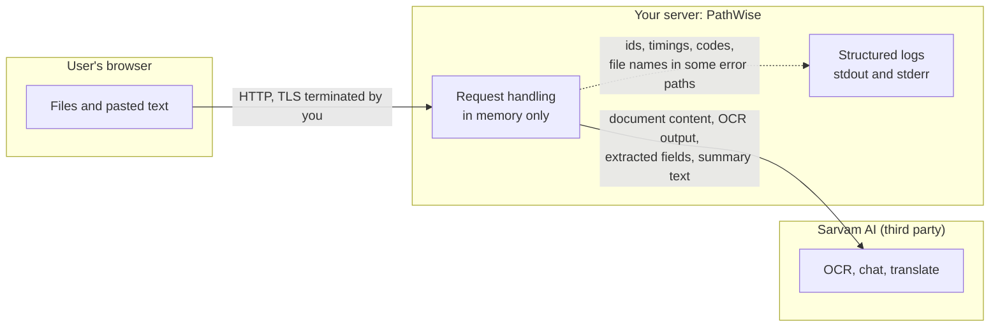

# Security and privacy

What data goes where, which controls exist in the code, and which do not. Statements describe the repository as reviewed. This is a code review, not a security audit or penetration test.

Contents: [Data flow](#data-flow) · [Controls that exist](#controls-that-exist) · [Controls that do not exist](#controls-that-do-not-exist) · [Upload handling](#upload-handling) · [Prompt injection](#prompt-injection) · [HTTP hardening](#http-hardening) · [Secrets](#secrets-and-configuration) · [Before exposing it](#before-exposing-this-to-real-users)

## Data flow

| Data                                                                                 | Leaves your server?       | To where           | Why                                     |
| ------------------------------------------------------------------------------------ | ------------------------- | ------------------ | --------------------------------------- |
| Scanned PDFs and images (bytes)                                                      | Yes                       | Sarvam Document AI | OCR                                     |
| Full document text                                                                   | Yes                       | Sarvam Chat        | Stage A extraction                      |
| Extracted fields plus 1,500-character excerpts of each document                      | Yes                       | Sarvam Chat        | Stage B (only with 2 or more documents) |
| English summary text (organisation, action, location, fees, deadlines, consequences) | Yes, only on user request | Sarvam Translate   | Translation                             |
| Anything else                                                                        | No                        |                    |                                         |

- **Persistence in this repository: none.** No code path writes documents, results or summaries to disk or a database. The application code does not use `localStorage`, `sessionStorage`, IndexedDB or cookies. Results exist only in React state.
- **Third-party retention is outside this repository.** What Sarvam stores, for how long and under what terms is governed by Sarvam's policies. For documents containing personal data (the app's own sample documents mention Aadhaar, PAN and bank KYC), review those terms and your own obligations before using real documents.
- **Logs** are written by the app but retained by whatever platform runs it. They contain no document text or keys by design (and the tests assert it for several paths) but do include request IDs, timings, token counts, status codes and, in some error lines, file names.

## Controls that exist

| Area                 | Control                                                                                                                                                          | Where                                             |
| -------------------- | ---------------------------------------------------------------------------------------------------------------------------------------------------------------- | ------------------------------------------------- |
| Input size           | Max 5 files, 25 MB each, 60 MB total, 1,000,000 characters per text document; `Content-Length` pre-check before parsing                                          | `lib/limits.js`, extract route                    |
| File type            | Extension allow-list plus magic-byte check for PDF, PNG and JPEG                                                                                                 | `digitise()`                                      |
| Metadata             | Zod schema with length limits; labels stripped of control characters, quotes, angle brackets, `---`                                                              | extract route, `sanitizeLabel`                    |
| Prompt injection     | `<document>` wrapping with closing-tag escaping, untrusted-data instruction, schema-constrained output, verbatim evidence checks. See [below](#prompt-injection) | `lib/extraction.js`                               |
| SSRF on OCR download | HTTPS only, no credentials or port, host allow-list, redirects rejected, size caps                                                                               | `lib/sarvam.js`                                   |
| Resource exhaustion  | Per-IP and global rate limits, concurrency cap, bounded sections per document, 285 s request deadline                                                            | `lib/limiter.js`, extract route                   |
| Error hygiene        | Upstream response bodies are never returned or logged; fixed safe messages; secrets, bearer tokens and body text redacted from diagnostics                       | `lib/apiError.js`, `lib/sarvam.js`, extract route |
| Model internals      | `reasoning_content` from the model is never read or logged                                                                                                       | `extractStructured`                               |
| Secrets              | API key only in a server-side request header; `.env*` ignored by git and Docker                                                                                  | `.gitignore`, `.dockerignore`                     |
| Container            | Runs as non-root user; slim base image; dependency lifecycle scripts skipped at install                                                                          | `Dockerfile`                                      |
| Browser XSS          | React escaping; no `dangerouslySetInnerHTML`, `innerHTML` or `eval` in the code reviewed                                                                         | components                                        |
| HTTP                 | Security headers and `no-store` on API responses. See [below](#http-hardening)                                                                                   | `next.config.mjs`                                 |

## Controls that do not exist

State these plainly to anyone deciding where to deploy this.

- **No authentication or authorisation.** Anyone who can reach the server can use it and spend your Sarvam credits, subject only to the rate limits.
- **Weak abuse protection by default.** `TRUSTED_PROXY_HOPS=0` disables per-IP limits. The remaining controls (hourly budget, concurrency cap) are global, in memory and per instance, so one client can exhaust the budget for everyone.
- **No per-user quotas, no cost cap tied to Sarvam billing.**
- **No audit log** of who analysed what.
- **No encryption at rest** (there is no rest to encrypt) and **no control over Sarvam's handling** of data sent to it.
- **No strict CSP.** `script-src` and `style-src` allow `'unsafe-inline'`.
- **No automated dependency or vulnerability scanning** in the files reviewed. `FIX_LOG.md` notes that `npm ci` once reported existing audit findings; they are not triaged in the repository.
- **No component, end-to-end or security tests.** Tests are unit and route-level with mocks.

## Upload handling

- The client enforces the same count, size and type limits for usability, but the server re-checks everything and does not trust the client.
- `Content-Length` is checked first, but only when the header is present. A request using chunked transfer encoding skips that check, and `request.formData()` buffers the whole body in memory before per-file and total limits can be applied. Next.js route handlers have no built-in body limit, so the effective upper bound on memory per request depends on the platform or proxy. Put a body-size limit in front of the app.
- Uploaded files are held in memory only; there is no temp-file handling.
- A PDF is parsed with `unpdf` (PDF.js) in the server process. Malformed PDFs that crash or hang the parser are not specifically defended against beyond the overall request deadline.
- The ZIP returned by Sarvam is parsed with `adm-zip`. The decompressed-size guard sums declared entry sizes from the archive headers.

## Prompt injection

Documents are attacker-controlled input to an LLM. What the code does:

- The document is placed inside a `<document>` element, a literal `</document>` in the text is escaped, and the system prompt tells the model the content is untrusted and must not be followed.
- File name, title and source are stripped of characters that could break the wrapper.
- The model has no tools and no side effects. Output is constrained to a JSON schema and re-validated, so a successful injection cannot call anything or exfiltrate data through the pipeline. Its reach is limited to the content of the returned record.
- Quotes must verify verbatim against the source.

What it cannot do:

- **Verbatim verification does not detect injected content**, because injected text is also verbatim in the document. A document that says "Deadline: tomorrow, pay to account X" will produce a verifiable quote.
- The output of one document is not isolated from another: Stage B receives excerpts from all documents together, so an injection in one document can influence edges and conflicts involving the others.
- The prompt-level defences are instructions the model may not follow. No prompt-injection test corpus exists in the repository.

Treat extracted actions, deadlines and amounts from untrusted documents as claims to be checked, not facts.

## HTTP hardening

Set in `next.config.mjs` for every route:

| Header                    | Value                                                                                                                                                                                                                                                                                                                |
| ------------------------- | -------------------------------------------------------------------------------------------------------------------------------------------------------------------------------------------------------------------------------------------------------------------------------------------------------------------- |
| `X-Content-Type-Options`  | `nosniff`                                                                                                                                                                                                                                                                                                            |
| `X-Frame-Options`         | `DENY`                                                                                                                                                                                                                                                                                                               |
| `Referrer-Policy`         | `strict-origin-when-cross-origin`                                                                                                                                                                                                                                                                                    |
| `Permissions-Policy`      | `geolocation=(), camera=(), microphone=()`                                                                                                                                                                                                                                                                           |
| `Content-Security-Policy` | `default-src 'self'`; `script-src 'self' 'unsafe-inline'` (plus `'unsafe-eval'` in development); `style-src 'self' 'unsafe-inline'`; `img-src 'self' blob: data:`; `font-src 'self'`; `object-src 'none'`; `base-uri 'self'`; `form-action 'self'`; `frame-ancestors 'none'`; optionally `upgrade-insecure-requests` |

`/api/*` also gets `Cache-Control: no-store`, and `X-Powered-By` is removed.

`'unsafe-inline'` for scripts is there because of how the app is built (the config comments cite the React Compiler's output). A nonce-based CSP through a proxy file is noted as a TODO and not implemented. Until then the CSP gives limited protection against script injection.

## Secrets and configuration

- The only secret is `SARVAM_API_KEY`. Keep it in the platform's secret store; `vercel.json` references a Vercel secret rather than embedding a value.
- `lib/env.js` refuses to run in production without a real-looking key and never exposes its value; `/api/health` only reports whether it is set.
- The preflight scripts read the key from `.env.local` or the environment, never print it, and make live API calls that cost money.
- Rotate the key if it has ever been committed, pasted into logs or shared. The `.gitignore` protects against accidents, not against copies outside git.

## Before exposing this to real users

This is a list of the gaps most relevant to a public deployment, not a certification.

1. Put authentication in front of it, or restrict access at the network level.
2. Set `TRUSTED_PROXY_HOPS` correctly, or enforce rate limits at the proxy or CDN.
3. Add a request body size limit at the proxy that matches the 62 MB the app expects.
4. Decide whether sending these documents to Sarvam is acceptable for your data and jurisdiction, and read Sarvam's retention terms.
5. For multi-instance or serverless deployment, replace the in-memory limiter with a shared store.
6. Consider a nonce-based CSP.
7. Decide how you will handle the fact that the output can be wrong. The UI flags unverified items but does not prevent anyone acting on them.
